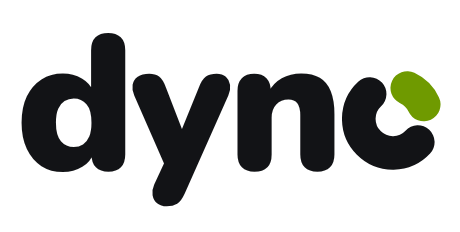
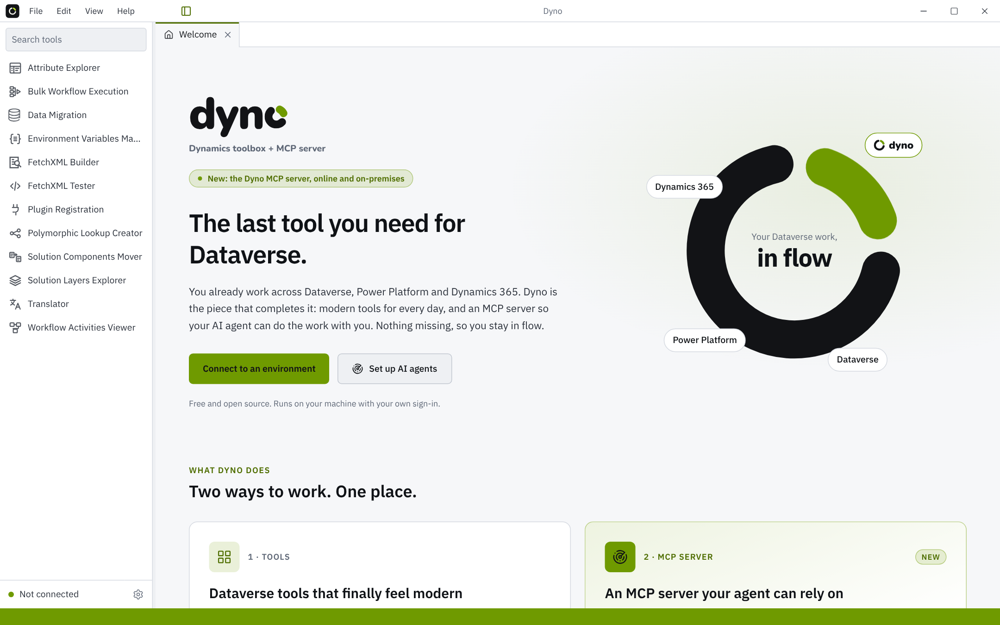
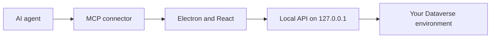

<p align="center">
  <picture>
    <source media="(prefers-color-scheme: dark)" srcset="docs/assets/readme/dyno-wordmark-dark.png">
    
  </picture>
</p>

<p align="center"><strong>Dynamics toolbox + MCP server</strong></p>

<p align="center">
  <a href="https://dyno.abdallahnagy.com/"></a>
  <a href="LICENSE"></a>
</p>

<p align="center">
  <a href="https://github.com/AbdallahNagy/Dyno/releases/latest/download/Dyno-Setup.exe"><strong>Download for Windows</strong></a> ·
  <a href="https://dyno.abdallahnagy.com/"><strong>Website</strong></a> ·
  <a href="CHANGELOG.md"><strong>Changelog</strong></a> ·
  <a href="https://github.com/AbdallahNagy/Dyno/issues"><strong>Issues</strong></a>
</p>

# The last tool you need for Dataverse

You already work across Dataverse, Power Platform and Dynamics 365. Dyno is the piece that completes it: modern tools for every day, and an MCP server so your AI agent can do the work with you. Nothing missing, so you stay in flow.

Dyno is a free, open-source Windows desktop app. It runs on your machine, connects directly to your environments with your own sign-in, and works with Dataverse online and on-premises. It was formerly called Power Tools.

<picture>
  <source media="(prefers-color-scheme: dark)" srcset="website/src/assets/images/app-welcome-dark.png">
  
</picture>

## Two ways to work. One place.

1. **Dataverse tools that finally feel modern.** The jobs you do every day, from FetchXML to plug-in steps to solution layers, in clear screens that are quick to learn and pleasant to come back to. A free, modern alternative to XrmToolBox, with 12 built-in tools.
2. **An MCP server your agent can rely on.** Let Claude Code, Claude Desktop or VS Code read and change your environments through Dyno, with your sign-in and the connections you already saved. The same tools on Dataverse online and on-premises.

## Tools

<!-- tools:start (generated by scripts/sync-readme-tools.mjs from desktop/src/ui/tools/publicCatalog.ts) -->

| Tool | What you can do |
| --- | --- |
| [Attribute Explorer](desktop/src/ui/tools/attribute-explorer/) | Browse every table in an environment and inspect its fields, types, and lookups. |
| [Bulk Workflow Execution](desktop/src/ui/tools/bulk-workflow-execution/) | Run an on-demand workflow against every record a view or FetchXML query returns, in batches you can pace and stop. |
| [Data Migration](desktop/src/ui/tools/data-migration/) | Move data between Dataverse environments with a guided, developer-friendly workflow that is easier to understand and control. |
| [Environment Variables Manager](desktop/src/ui/tools/environment-variables-manager/) | Find every environment variable in an environment, edit current values in place and save them together, and create, update, or delete definitions. |
| [FetchXML Builder](desktop/src/ui/tools/fetchxml-builder/) | Build, test, and refine FetchXML queries in a cleaner workspace built for fast iteration. |
| [FetchXML Tester](desktop/src/ui/tools/fetchxml-tester/) | Paste a FetchXML query, run it as written, and keep a local library of the queries you use. |
| [Plugin Registration](desktop/src/ui/tools/plugin-registration/) | Browse and manage plug-in assemblies, types, steps, and images. |
| [Polymorphic Lookup Creator](desktop/src/ui/tools/polymorphic-lookup-creator/) | Create, update, and delete polymorphic lookups in the selected environment. |
| [Solution Components Mover](desktop/src/ui/tools/solution-components-mover/) | Copy solution components from selected solutions into unmanaged solutions in the same environment. |
| [Solution Layers Explorer](desktop/src/ui/tools/solution-layers-explorer/) | See every solution layer of a Dataverse component, compare any two layers side by side, and remove the unmanaged Active layer. |
| [Translator](desktop/src/ui/tools/translator/) | Edit the display names and descriptions of tables, columns, choices, views, and charts side by side in every language installed in an environment. |
| [Workflow Activities Viewer](desktop/src/ui/tools/workflow-activities-viewer/) | See which activated processes reference a custom workflow activity. |

<!-- tools:end -->

Each tool opens in its own tab. The activity-bar tools can stay open in more than one tab at a time, and each tab keeps its own state.

## MCP server for AI agents

> The MCP server is new and not in a release yet. It is listed under Unreleased in the [changelog](CHANGELOG.md).

Describe the outcome, approve the plan, done. Your agent says what it wants your environment to look like. Dyno reads the environment, works out exactly what has to change, and shows you that plan before anything runs.

1. **Turn on the server** under Settings > Agents (MCP). It is off by default and stays on your machine.
2. **Connect your client.** Dyno shows the setup for Claude Code, Claude Desktop or VS Code, ready to copy. No token goes in any config file.
3. **Ask for what you want.** Tables, columns, forms, views, plug-ins, flows, roles, solutions and records.

| | |
| --- | --- |
| Reads never ask | Schema, forms, solutions, queries |
| Changes ask you first | Or trust a dev connection |
| Deletes always ask | No setting turns this off |
| Online and on-premises | The same tools on both |

The [MCP server guide](desktop/docs/mcp-server.md) lists every tool and how approvals work.

## Download

The published installer is for Windows.

1. Download [Dyno-Setup.exe](https://github.com/AbdallahNagy/Dyno/releases/latest/download/Dyno-Setup.exe), or start from the [download page](https://dyno.abdallahnagy.com/download).
2. Run the installer on your machine.
3. Open Dyno and connect to an environment.
4. The installed app checks for later releases.

### Connections

- **Online.** Enter the environment URL. A browser window opens for Microsoft sign-in. Saved connections come back after a restart.
- **On-premises.** Connect with Active Directory or IFD.

Switch or remove connections from the status bar.

## Your data stays local

Dyno runs on your machine and connects directly to Dataverse. Your Dataverse data stays on your machine, and the MCP server runs locally too. The [website](https://dyno.abdallahnagy.com/) introduces the app. It does not host or process your Dataverse data.

The interface calls Dataverse through a local ASP.NET Core API bound to `127.0.0.1`. The desktop app starts that API and stops it when the app exits.



## Repository

| Path | What it is |
| --- | --- |
| [`desktop/`](desktop/) | Electron and React client. Windows is the production target. |
| [`api/Dyno/`](api/Dyno/) | Local ASP.NET Core API the desktop app starts. |
| [`website/`](website/) | Product website, deployed to Cloudflare Workers. |

## Develop

Install [Node.js 24](https://nodejs.org/) and the [.NET 9 SDK](https://dotnet.microsoft.com/download/dotnet/9.0). `npm run dev` starts the React app, Electron, and the local API. The API is launched with `dotnet run`, so `dotnet` has to be on `PATH`.

```bash
cd desktop
npm ci
npm run dev
```

Desktop CI runs this check on Windows:

```bash
cd desktop
npm run check
```

`npm run check` type-checks, lints with zero warnings, runs unit tests, builds the renderer, and runs the Electron smoke test.

API tests:

```bash
dotnet test api/Dyno/Dyno.sln
```

Website (the deploy workflow uses pnpm 11.9):

```bash
cd website
pnpm install
pnpm dev
```

Claude Code cloud sessions (Ubuntu): set the environment's setup script to `bash Dyno/scripts/cloud-setup.sh`. It installs the .NET SDK and .NET 9 runtimes, restores the API, and runs `npm ci` in `desktop/`. Run `npm run dev:cloud` from `desktop/` instead of `npm run dev`: it adds a virtual display, the `--no-sandbox` flag Electron needs as root, and turns off crash reports. To launch the whole app headless (renderer, Electron, and API) and save a screenshot:

```bash
xvfb-run -a node scripts/cloud-app.mjs --tool "FetchXML Builder"
```

Run the Electron smoke test the same way with `xvfb-run -a npm run test:smoke` from `desktop/`.

Build a Windows installer from source:

```bash
cd desktop
npm run dist:win
```

## Contributing

Issues and pull requests are welcome.

- Report a bug from real Dataverse work.
- Suggest a rough edge in a tool you already use.
- Open an issue before starting a new tool, so the scope is clear.

Add user-visible desktop changes under `## [Unreleased]` in [CHANGELOG.md](CHANGELOG.md). [docs/releasing.md](docs/releasing.md) covers how releases are cut.

For desktop changes, run `npm run check` from `desktop/` before opening a pull request. [Desktop CI](.github/workflows/desktop-ci.yml) runs that same check.

## License

[MIT](LICENSE) © Abdallah Nagy

## Contact

Abdallah Nagy — [abdallah@abdallahnagy.com](mailto:abdallah@abdallahnagy.com)

- [GitHub issues](https://github.com/AbdallahNagy/Dyno/issues)
- [Contact page](https://dyno.abdallahnagy.com/contact)
