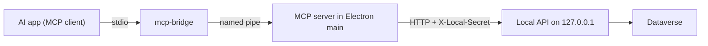

# MCP server

Power Tools can act as a Model Context Protocol (MCP) server. AI apps such as Claude Desktop, Claude Code, Cursor, and VS Code can then call Power Tools against the connections the user has already signed in to. This page is the design. Nothing on it is built yet.

## Goals

- Let an AI app read Dataverse metadata, run FetchXML, and inspect solution layers, plug-in steps, and workflow activity usage through Power Tools.
- Reuse the sidecar endpoints the tools already call. No second implementation of Dataverse logic.
- Reuse the user's saved connections and sign-in. No credentials in the AI app's config.
- Off until the user turns it on. Read-only in the first release.

Not goals for the first release:

- Writing to Dataverse.
- Working while Power Tools is closed.
- Reaching Power Tools from another machine.

## Architecture



### Why the server lives in Electron main

- Online tokens are acquired by MSAL in `src/electron/auth.ts`. The sidecar only receives a token on each request (`DataverseContextFilter`). A server inside the sidecar could not get a token on its own.
- Saved connections, their environment kind, and the per-launch sidecar port and secret (`src/electron/sidecar.ts`) are already in main.
- Each MCP tool becomes a thin call to an existing sidecar endpoint, with the same headers the renderer client sets in `src/ui/shared/api/client.ts`.

The server uses the official TypeScript SDK, `@modelcontextprotocol/sdk`, and lives in `src/electron/mcp/`. It never runs in the renderer.

### Why a stdio bridge

The sidecar port and secret change on every launch, so no AI app can be configured to call the sidecar directly. Every MCP client supports stdio, so the AI app starts a small bridge with a fixed command. The bridge:

- Connects to the named pipe and copies MCP messages in both directions. It does not parse them.
- Holds no token, secret, or connection data.
- Ships inside the installer and runs with the installed `PowerTools.exe` in Node mode (`ELECTRON_RUN_AS_NODE=1`), so users install nothing else.
- When the pipe is missing, answers the MCP `initialize` request itself and returns one tool error on every call: "Open Power Tools to use these tools."

Claude Desktop config the app will offer to copy:

```json
{
  "mcpServers": {
    "power-tools": {
      "command": "C:\\Users\\<user>\\AppData\\Local\\Programs\\PowerTools\\PowerTools.exe",
      "args": ["<install dir>\\resources\\mcp-bridge.cjs"],
      "env": { "ELECTRON_RUN_AS_NODE": "1" }
    }
  }
}
```

The exact path comes from the running app, never from this page.

### Named pipe

- Name: `\\.\pipe\powertools-mcp-<user SID hash>`, so two Windows users on one machine never share a pipe.
- The pipe is created with a security descriptor that allows only the current user.
- Main opens it when the setting is on and closes it when the setting is turned off or the app quits.
- Each bridge connection is one MCP session. Several AI apps can be connected at once.

Development runs on macOS and Linux use a Unix socket in the user data folder with mode `0600`. Windows is the production target.

## Connections

### Which connection a call uses

Every tool takes an optional `connection` argument: the connection id from `list_connections`. Without it, the call uses the **MCP default connection** chosen in Settings. The active tab's connection is not used, because it changes under the AI app without the user noticing.

### Which connections are allowed

A connection is reachable over MCP only when the user has allowed it in Settings. The allow list is stored in `settings.json` as connection ids, under `mcp.allowedConnectionIds`. A connection that is not allowed does not appear in `list_connections`, and a call that names it fails with "This connection is not available to AI apps. Allow it in Settings → AI apps."

### Production is blocked by default

A connection whose environment kind is `production` cannot be allowed with the normal checkbox. Allowing it takes a second, explicit confirmation that names the environment. The kind comes from `environmentKind()` in `src/ui/shared/connections/connectionNaming.ts`, the same rule that gives production tabs a red header.

That rule reads the environment name, so a production environment named "main" reads as `other`. Two safeguards cover this:

- Nothing is reachable until the user allows it, connection by connection. There is no "allow all".
- The allow list shows each connection's URL, not only its name.

Main has to classify connections without importing renderer code. Phase 2 moves `environmentKind()` and its word list into a module both sides import, so the rule is defined once.

If a connection is renamed so that it becomes production, it is removed from the allow list and needs the production confirmation again.

### Tokens

- Online: main calls MSAL `acquireTokenSilent` only. If that fails, the call returns "Sign in to <connection> in Power Tools" and the app shows a notice. An AI call never opens a sign-in window. Phase 2 adds a silent-only function next to `acquireTokenSilentOrInteractive` in `auth.ts`.
- On-premises: main registers the stored connection with the sidecar as it does for the renderer, then sends `X-Connection-Name`. A connection that still needs its password fails with the existing "Enter the password" message.
- Tokens never appear in tool results, logs, or errors.

## Tools in the first release

All are read-only. Each maps to an existing sidecar endpoint.

| Tool | Sidecar endpoint | Returns |
| --- | --- | --- |
| `list_connections` | none (connection store) | Allowed connections: id, display name, environment kind, URL, online or on-premises. Marks the default. |
| `list_tables` | `GET /api/metadata/entities` | Logical name, display name, primary id and name columns |
| `describe_table` | `GET /api/attribute-explorer/tables/{logicalName}/attributes` and `GET /api/metadata/entities/{logicalName}/relationships` | Columns with type, required level, lookup targets, choice values; relationships |
| `run_fetchxml` | `POST /api/fetch/execute` | Records, columns, column types, `moreRecords`, a paging cookie |
| `find_solution_components` | `GET /api/solution-layers/components` | Components matching a type, search text, or table |
| `get_solution_layers` | `GET /api/solution-layers/layers` | Every layer of one component, with solution, publisher, and order |
| `list_plugin_steps` | `GET /api/plugin-registration/catalog` | Assemblies, types, steps, and images. The endpoint has no filters, so main filters by message, table, or assembly. |
| `find_workflow_activity_usages` | `GET /api/workflow-activities/` and `GET /api/workflow-activities/{pluginTypeId}/processes` | Activated processes that use a custom workflow activity |

Rules for every tool:

- Input is validated with a schema before any sidecar call.
- `run_fetchxml` returns at most 250 rows per call, the sidecar's `FetchXmlPreparation.MaxPageSize`. It uses the existing `Page`, `PageSize`, and `PagingCookie` fields with `ValueMode = "formatted"`. The AI app asks for the next page with the cookie.
- Other results are capped at 200 items, with a `truncated` flag and a hint on how to narrow the request.
- Sidecar errors are returned as MCP tool errors with the message from `DataverseErrorFormatter`. Stack traces are not returned.
- Tool descriptions say which connection the result came from, so the AI app can repeat it to the user.

`remove-active` on solution layers and every other write endpoint stay out of the first release.

## Settings and visibility

Settings gets an **AI apps** section:

- **Let AI apps use Power Tools**: off by default.
- **Allowed connections**: a checklist with name, kind, and URL. Production needs the second confirmation.
- **Default connection**: one of the allowed connections.
- **Copy config**: buttons for Claude Desktop, Claude Code, Cursor, and VS Code. Each copies the snippet with the real install path.
- **Recent calls**: the last 50 calls in this session, with time, tool, connection, duration, and result (ok or error message). Kept in memory only; arguments such as FetchXML are shown, results are not stored.

While a client is connected, the status bar shows an "AI apps" indicator with the call count. Clicking it opens the section above.

### What the user is told

The section says, in plain words:

> AI apps you connect can read data from the environments you allow. Your AI app sends what it reads to its own AI service. Power Tools does not send anything itself.

The website's "Your data stays local" text gets the same caveat once the feature ships.

## Threat model

| Risk | Control |
| --- | --- |
| Another local user or process calls the server | Pipe is limited to the current user. The sidecar still requires `X-Local-Secret`, which only main knows. |
| A process running as the same user calls the server | Same trust level as that user's MSAL cache file. Mitigated by the off-by-default switch, the allow list, and the visible call log. |
| Prompt injection in Dataverse data makes the AI app misuse tools | The first release is read-only. Writes later require an in-app confirmation the AI app cannot answer. |
| AI app reads production by mistake | Production is blocked by default and needs a named confirmation. |
| Large results flood the AI app or the sidecar | Row and item caps, paging, and the existing sidecar timeouts. |
| Tokens or passwords leak through results or logs | Tools return DTOs only. The call log stores no results. Errors go through `DataverseErrorFormatter`. |

## Phases

1. **Design.** This page.
2. **Plumbing.** `src/electron/mcp/`: pipe server, bridge script, MCP session setup, settings keys, allow list, the shared `environmentKind()` module, silent-only tokens, and the "app not open", "not allowed", and "sign in" errors. `list_connections` as the first tool.
3. **Read-only tools.** One file per tool in `src/electron/mcp/tools/`, each mapping input to one sidecar call.
4. **Settings and docs.** The AI apps section, copy-config buttons, status bar indicator, call log, website page, and a `CHANGELOG.md` entry.
5. **Writes, later.** Candidates: run a bulk workflow, apply translations, copy solution components, remove an Active layer. Each needs an in-app confirmation dialog that shows the connection and the exact change, and its own decision before it is built.

## Tests

- **Unit, per tool:** a fake sidecar records the request. Tests check the endpoint, headers, query, and body for given tool input, and the shape of the result and of errors.
- **Session:** the SDK's in-memory transport connects a real MCP client to the server. Tests cover `tools/list`, a call on the default connection, a call naming another connection, a connection that is not allowed, a production connection that is not confirmed, and a silent token failure.
- **Bridge:** start the bridge against a test pipe and pass messages through. Start it with no pipe and check the "Open Power Tools" error.
- **Settings:** renaming a connection to production removes it from the allow list.

Tests use fakes only. No test needs a Dataverse environment or real credentials.

## Open questions

None. Decided: the server runs in Electron main, production connections are blocked by default, and the first release is read-only.
