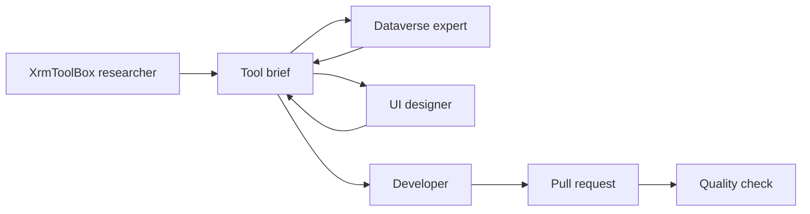

# Tool-building pipeline

New Dataverse tools start with the `xrmtoolbox-plugin-researcher` agent. Neither Cursor nor Claude Code passes one agent's chat to the next. Handoff is the brief file below. Dataverse review and UX run in parallel after research. The developer starts only when both sections are written.

## Cursor and Claude Code

The agents are defined once in `.cursor/agents/`. `.claude/agents/` holds generated copies with the same names, so Claude Code runs the same agents. After editing an agent in `.cursor/agents/`, run `node scripts/sync-agents.mjs` from the repository root and commit both files. Claude Code also runs the sync when a session starts, and the `Agents sync` workflow fails a pull request whose copies are stale. Do not edit `.claude/agents/*.md` directly.

In Claude Code, `/build-tool <tool name>` runs every stage below in order and stops at the same user decisions.

## Dataverse MCP server

The repository registers Microsoft's Dataverse MCP server as `dataverse` in `.mcp.json` (Claude Code) and `.cursor/mcp.json` (Cursor). The Dataverse expert uses it to confirm metadata and query behavior against a live environment instead of documentation alone. It is optional. Without it, the pipeline runs as before.

To turn it on:

1. Use a development or sandbox environment, never production.
2. Complete the prerequisites in the [`@microsoft/dataverse` README](https://www.npmjs.com/package/@microsoft/dataverse): tenant admin consent, enable the Dataverse MCP server for the environment, and allow the "Dataverse MCP CLI tool" client app.
3. Set `POWERTOOLS_DEV_DATAVERSE_URL` to the environment URL, for example `https://contoso-dev.crm.dynamics.com`. Do not commit the URL.
4. Sign in once with `npx @microsoft/dataverse@1.0.82 auth create --environment <url>`, then check with `npx @microsoft/dataverse@1.0.82 mcp <url> --validate`.
5. Restart Claude Code or Cursor and approve the `dataverse` server when asked.

The server can also write data. `.claude/settings.json` denies its create, update, and delete tools in Claude Code, and the Dataverse expert is told to use read tools only. Cursor has no project-level deny list, so keep the environment disposable.

## Roles

| Order | Agent file | Writes |
| --- | --- | --- |
| 1 | `.cursor/agents/xrmtoolbox-plugin-researcher.md` | Match and backend findings, in the sections that file already specifies |
| 2, in parallel | `.cursor/agents/dataverse-expert.md` | Dataverse review |
| 2, in parallel | `.cursor/agents/power-tools-ux.md` | UX |
| 3, after both sections exist | `.cursor/agents/power-tools-developer.md` | Implementation notes, test evidence, and a draft pull request |
| 4 | `.cursor/agents/power-tools-reviewer.md` | Short pass or fail on the pull request |

Save the researcher's brief unchanged as the start of the handoff file before Dataverse review or UX begins. Do not edit `.cursor/agents/xrmtoolbox-plugin-researcher.md` to change that output.

Stop and ask the user only for an ambiguous tool name, a GPL or other copyleft license, or two real product scopes. Mark ordinary uncertainty in the owning section instead of opening a question.

## Brief file

One file per tool:

`desktop/docs/tools/<tool-id>/brief.md`

`<tool-id>` is the kebab-case id from the researcher's Power Tools mapping.

Each role appends its own section and does not rewrite earlier sections. Parallel roles append only their own heading. If that heading is already present, stop.

The file starts with the researcher's sections, copied as written:

- `### Match`
- `### What it does`
- `### Backend findings`
- `### Power Tools mapping`
- `### Recommended implementation`

Later roles append, in this order when both parallel sections are present:

### Dataverse review

Corrections, privileges, and limits. Include online versus on-premises behavior, solution and managed limits, failure modes, and anything the XrmToolBox plugin got wrong or left unverified.

### UX

Screens, empty and error states, and what not to build. This section is written from the capability list in `### What it does` only.

### Implementation notes and test evidence

What the developer changed, which checks ran, and the results.

### Open questions

Only decisions the user must make. Write `None.` when there are none. Do not delete questions an earlier role already appended.

## Multiple tabs

Activity-bar tools allow more than one tab by default. Set `allowMultipleInstances: true`. Choosing the tool in the sidebar opens another tab, and each tab keeps its own state. A tool sets `allowMultipleInstances: false` only when a second tab cannot work, and the brief says why. Welcome stays a single tab. One selected environment is not a reason to block a second tab.

## Public listing

Activity-bar tools appear on the welcome page and the website from one list: `desktop/src/ui/tools/publicCatalog.ts`.

`PUBLIC_TOOLS` follows `ACTIVITY_BAR_TOOLS` in `desktop/src/ui/tools/registry.tsx`. Each entry uses that tool's id and title, plus the one-sentence description from `### UX`.

The welcome page, `website/src/pages/index.astro`, and the website's Tools tab (`website/src/pages/tools/index.astro`) render `PUBLIC_TOOLS`. Adding a tool means adding that catalog entry. It does not mean editing any screen's tool markup. Welcome is not a public tool.

### Website tool page

Every public tool also has its own page at `/tools/<tool-id>/`, so people and search engines can find it. The page route and the sitemap come from `PUBLIC_TOOLS`. The page text comes from one Markdown file:

`website/src/content/tools/<tool-id>.md`

The file name is the catalog id. The catalog owns the title and the one-sentence description, so the file does not repeat them. The frontmatter schema is in `website/src/content/config.ts`:

- `seoTitle`: the page `<title>`, under about 65 characters, ending with `| PowerTools`. Lead with the words people search for, such as `Dataverse` or `Dynamics 365` and the job.
- `seoDescription`: 140 to 160 characters. Say what the tool does in plain words.
- `xrmToolBoxEquivalent`: the XrmToolBox plugin name from `### Match`, when there is one. Omit it otherwise.
- `features`: three to six short capability bullets, taken from `### What it does` and limited to what Power Tools ships per `### UX` and the Dataverse review.

The body is three or four `##` sections: what the tool is for, how it works, and `## When to use it` with real developer scenarios. Write for a Dataverse developer who has never opened the app. Describe only shipped behavior; leave out anything in "what not to build". Do not copy wording from the XrmToolBox plugin. Use other tool pages in that folder as the model.

The website build fails when a catalog tool has no page, and `desktop/test/publicCatalog.test.ts` fails too. Run `pnpm build` from `website/` when you can.

## Developer gate

`power-tools-developer` does not implement, branch, or open a pull request until `desktop/docs/tools/<tool-id>/brief.md` contains both `### Dataverse review` and `### UX`, and each of those sections has at least one sentence or list item. Missing either section means the brief is not ready.
