# Power Tools architecture

This page shows how Power Tools fits together, from the Windows app down to the Dataverse call, and how code moves from a pull request to an installed app. It describes the code as it is today. Folder rules live in the `AGENTS.md` files; this page links to them instead of repeating them.

- [1. What Power Tools is](#1-what-power-tools-is)
- [2. System context](#2-system-context)
- [3. Runtime containers](#3-runtime-containers)
- [4. Repository map](#4-repository-map)
- [5. Electron main process](#5-electron-main-process)
- [6. Preload bridge](#6-preload-bridge)
- [7. Renderer](#7-renderer)
- [8. Local API (sidecar)](#8-local-api-sidecar)
- [9. Key flows](#9-key-flows)
- [10. Connections, credentials, and local data](#10-connections-credentials-and-local-data)
- [11. Security model](#11-security-model)
- [12. Updates, crash reports, and usage stats](#12-updates-crash-reports-and-usage-stats)
- [13. Website](#13-website)
- [14. Build, test, and release](#14-build-test-and-release)
- [15. Adding a tool](#15-adding-a-tool)
- [16. Design decisions and limits](#16-design-decisions-and-limits)

## 1. What Power Tools is

Power Tools is a Windows desktop toolkit for Dataverse and Dynamics 365 developers. Each tool, such as Plugin Registration or Data Migration, opens in its own tab against one connected environment.

Three parts ship from this repository:

| Part | Folder | Technology | Runs where |
| --- | --- | --- | --- |
| Desktop app | `desktop/` | Electron 39, React 19, TypeScript, Vite, Tailwind, TanStack Query | The user's Windows machine |
| Local API (sidecar) | `api/PowerTools/` | ASP.NET Core minimal API on .NET 9, Dataverse ServiceClient | The user's machine, on `127.0.0.1` |
| Website | `website/` | Astro static site, Cloudflare Worker | Cloudflare |

Dataverse data never leaves the user's machine except to go to the user's own environment.

## 2. System context

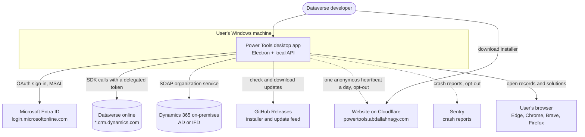

## 3. Runtime containers

The desktop app is four processes. The renderer never talks to Dataverse or Entra ID itself. It asks the main process for a token over IPC, then calls the sidecar over loopback HTTP, and the sidecar calls Dataverse.

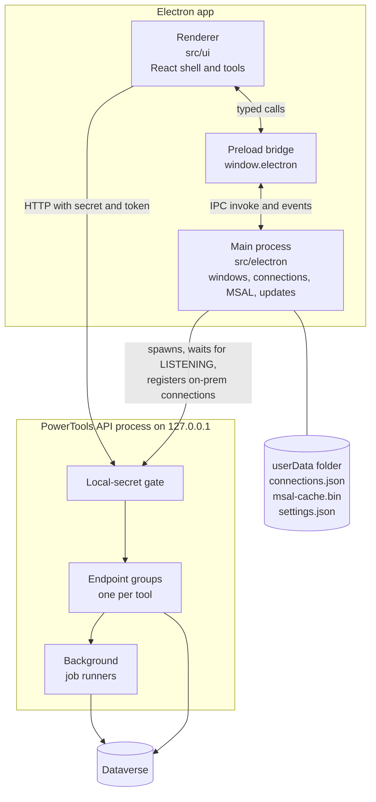

| Process | Owns | Must not |
| --- | --- | --- |
| Main | App lifecycle, windows, sidecar lifecycle, connection store, MSAL token cache, credential encryption, browser launching, updates, crash reports, usage stats | Run Dataverse queries |
| Preload | One typed method per IPC operation, exposed as `window.electron` | Expose raw `ipcRenderer` |
| Renderer | Shell, tabs, tool UI, query caching | Hold secrets beyond a short-lived access token, use raw IPC outside `platform/`, reach any origin except the sidecar |
| Sidecar | Every Dataverse call, long-running jobs | Listen on anything but `127.0.0.1`, store anything on disk |

## 4. Repository map

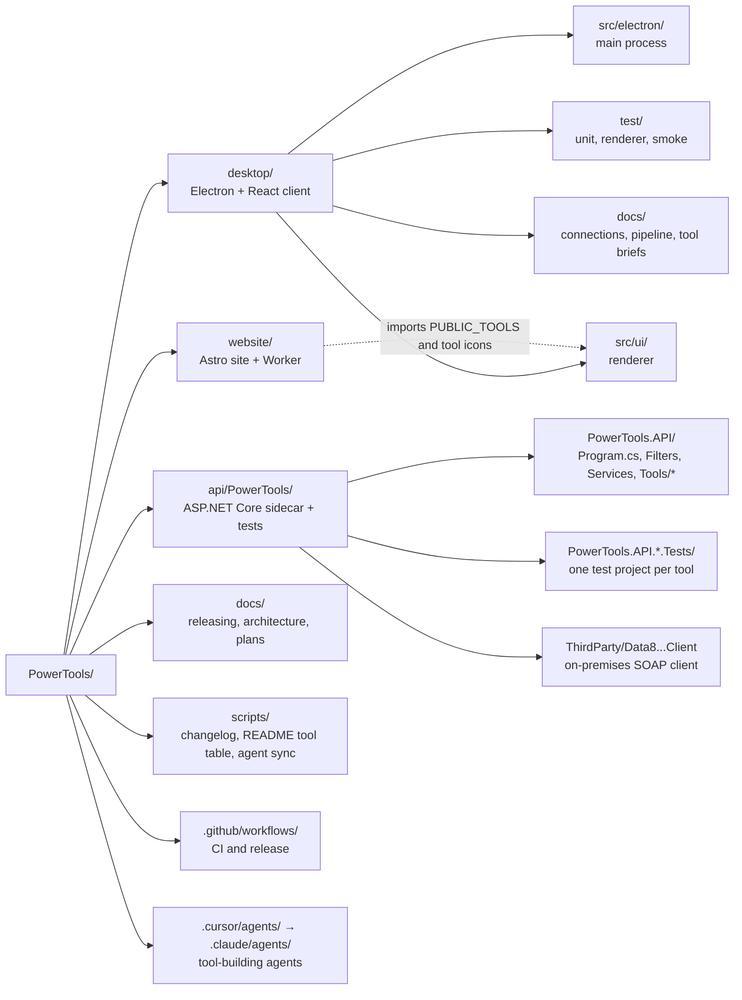

The website reads the desktop tool catalog at build time, so the tool list is defined once.

## 5. Electron main process

`main.ts` only composes services and runs startup. Rules are in [`desktop/src/electron/AGENTS.md`](../desktop/src/electron/AGENTS.md).

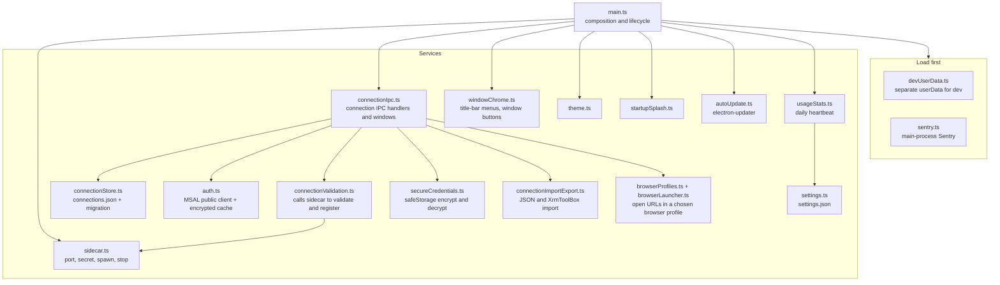

Startup order:

1. Load `devUserData` and `sentry`.
2. Show the splash window.
3. Start the sidecar and wait for `LISTENING <port>`. If it fails, show an error and quit.
4. Register IPC handlers and the connection store.
5. Register saved on-premises connections with the sidecar.
6. Create the main window. When it is ready, close the splash, start update checks and usage stats.

## 6. Preload bridge

`preload.cts` exposes `createPreloadApi(ipcRenderer)` as `window.electron`. Each method maps to one IPC channel.

The renderer reaches it only through `src/ui/platform/desktopBridge.ts`, which defines the typed `DesktopBridge` interface. Tools never call `window.electron`.

| Group | Methods |
| --- | --- |
| Connections | `listConnections`, `getConnection`, `getActiveConnection`, `setActiveConnection`, `refreshToken`, `updateConnection`, `deleteConnection`, `onConnectionsUpdated`, `onConnectionStatusUpdate` |
| Connection windows | `createConnectionWindow`, `saveConnectionData`, `saveConnectionDetails`, `openConnectionManager`, import and export |
| Browser | `listBrowsers`, `openUrlForConnection`, `openUrlInBrowser`, `openExternalUrl` |
| Sidecar bootstrap | `getApiBaseUrl`, `getLocalSecret` |
| Updates | `getUpdateStatus`, `checkForUpdates`, `downloadUpdate`, `installUpdate`, `onUpdateStatusChanged` |
| Window | `popupAppMenu`, `minimizeWindow`, `toggleMaximizeWindow`, `closeWindow`, `isWindowMaximized` |

## 7. Renderer

### Layers

Rules are in [`desktop/AGENTS.md`](../desktop/AGENTS.md) and [`desktop/src/ui/tools/AGENTS.md`](../desktop/src/ui/tools/AGENTS.md).

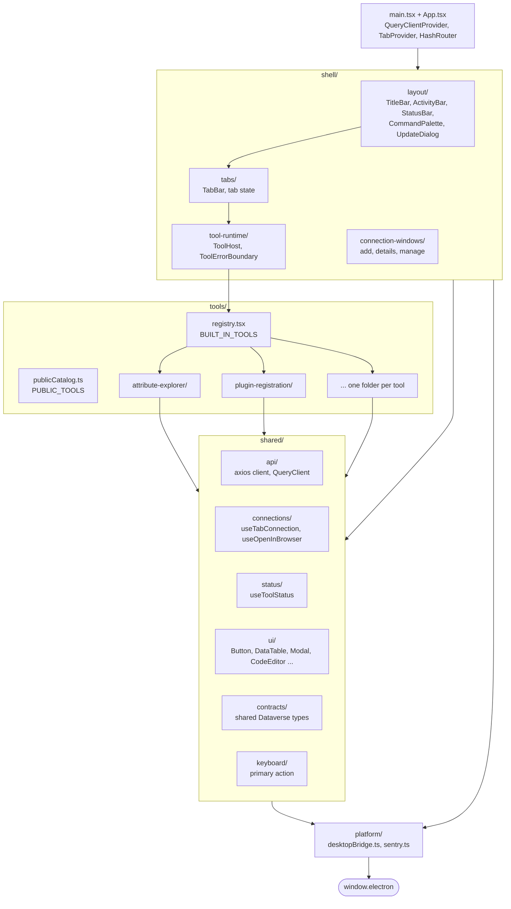

Allowed imports point down. Tools import `shared/` and `platform/` only. They never import another tool or `shell/` internals, and `shared/` never imports a tool.

### Tabs and tools

- A tool is a `ToolDefinition` from `defineTool()` in its `tool.ts`: id, title, icon, component, and `allowMultipleInstances`.
- `registry.tsx` lists every tool once. `createToolRegistry` rejects duplicate ids.
- Opening a tool creates a `TabData` with a unique instance id. The tab copies the active connection's id when it opens, so each tab keeps its own environment.
- `ToolHost` gives the tool a `ToolRuntimeContext` (`toolId`, `instanceId`, `connectionId`) and wraps it in an error boundary, so one tool crash does not take down the shell.
- Tools read their connection with `useTabConnection()` and publish status-bar items with `useToolStatus()`.

### Tool folder anatomy

```text
src/ui/tools/<tool-id>/
  tool.ts               ToolDefinition, the only export the registry reads
  <ToolName>.tsx        root component
  <tool-id>-icon.svg    activity-bar icon, also used by the website
  api/                  React Query hooks and query keys that call the sidecar
  model/                types and pure logic
  components/           private UI
  state/                optional reducers or stores
  tests/                Vitest tests with MSW fakes
```

### Data access

`shared/api/client.ts` is one axios instance used by every tool.

- On the first request it asks the main process for the sidecar URL and secret, then caches them.
- For each request it resolves the connection from `meta.connectionId` and adds headers. Online connections send `Authorization: Bearer` and `X-Environment-Url`. On-premises connections send `X-Connection-Name` with the connection id.
- `meta.targetConnectionId` adds `X-Target-*` headers for two-environment tools such as Data Migration.
- Tokens are refreshed when they are within five minutes of expiry. Concurrent refreshes share one IPC call.
- On a 401 it refreshes once and replays the request. Mutations that are not safe to repeat set `meta.noAuthRetry`.
- TanStack Query caches results, keyed by tool, connection id, and arguments. Switching the active connection clears cached auth and invalidates queries.

The renderer's Content Security Policy (`desktop/contentSecurityPolicy.ts`) only allows `connect-src` to `'self'` and `http://127.0.0.1:*`.

## 8. Local API (sidecar)

### Request pipeline

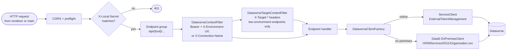

`Program.cs` reads three arguments from Electron:

| Argument | Purpose |
| --- | --- |
| `--port` | Loopback port chosen by Electron. Required. |
| `--secret` | 32-byte random hex secret for this launch. Required. |
| `--parentPid` | Electron's PID. A watchdog exits the sidecar when Electron exits, so no orphan stays running. |

When the server is up it prints `LISTENING <port>`. Electron waits for that line, up to 30 seconds, before it opens the main window.

### Endpoint groups

Each tool has a folder under `PowerTools.API/Tools/<Tool>/` with an `Endpoints` class registered in `Program.cs`.

| Group | Folder | Main pieces |
| --- | --- | --- |
| Connection | `Tools/Connection` | `/api/connect` (WhoAmI), validate and register on-premises connections |
| Metadata | `Tools/Metadata` | Tables, views, default view columns |
| Fetch | `Tools/Fetch` | Run FetchXML with paging and value modes |
| Attribute Explorer | `Tools/AttributeExplorer` | Tables and attributes |
| Data Migration | `Tools/DataMigration` | Preview, run, job status. Uses source and target connections |
| Plugin Registration | `Tools/PluginRegistration` | Catalog, assemblies, steps, images, unregister, assembly inspection. Uses a gateway interface for testing |
| Polymorphic Lookup | `Tools/PolymorphicLookup` | Create, update, delete polymorphic lookups |
| Workflow Activities | `Tools/WorkflowActivities` | Find processes that use a custom activity |
| Solution Components Mover | `Tools/SolutionComponentsMover` | Solutions, component types, copy jobs |
| Bulk Workflow Execution | `Tools/BulkWorkflowExecution` | Workflows, record queries, run jobs |
| Translator | `Tools/Translator` | Labels in every installed language, apply jobs |
| Solution Layers | `Tools/SolutionLayers` | Layers, compare, remove active layer, with a cache |

Most tool folders follow the same shape:

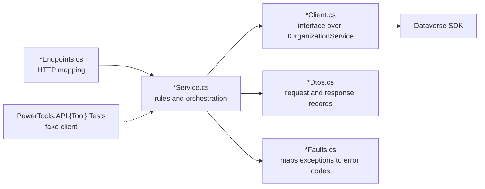

The client interface lets each test project replace Dataverse with a fake.

### Background jobs

Long operations do not hold an HTTP request open. The endpoint validates the request, saves a job with the caller's connection context in an in-memory store, and returns a job id. A hosted `BackgroundService` runs the job. The renderer polls the job's status endpoint with React Query `refetchInterval` until it reaches an end state.

| Job | Store | Runner |
| --- | --- | --- |
| Data migration | `IMigrationJobStore` | `MigrationJobRunner` |
| Solution component copy | `ISolutionCopyJobStore` | `SolutionCopyJobRunner` |
| Bulk workflow run | `IBulkWorkflowJobStore` | `BulkWorkflowJobRunner` |
| Translator apply | `ITranslatorJobStore` | `TranslatorJobRunner` |

Jobs live only in memory. Closing the app ends them.

## 9. Key flows

### App startup

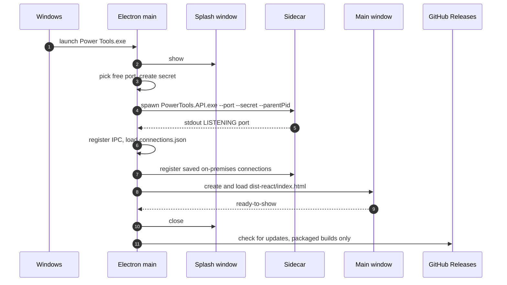

### Add an online connection

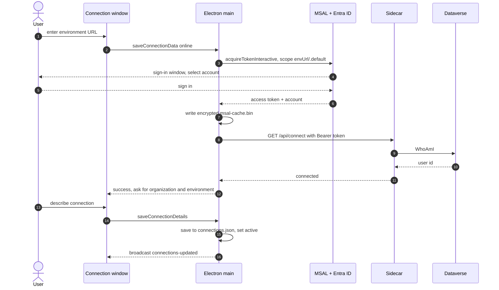

On-premises connections follow the same path, except the main process encrypts the password with `safeStorage`, calls `/api/connections/validate-onpremise`, and then `/api/connections/register-onpremise`. The sidecar keeps the on-premises credentials in memory, keyed by connection id.

### A tool reads data

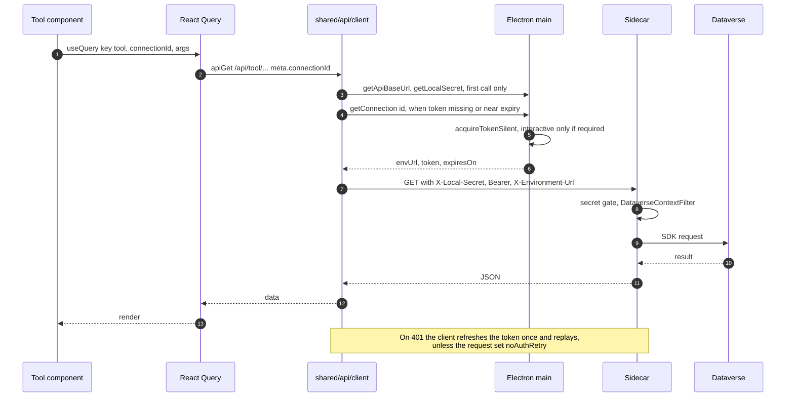

### A long-running job

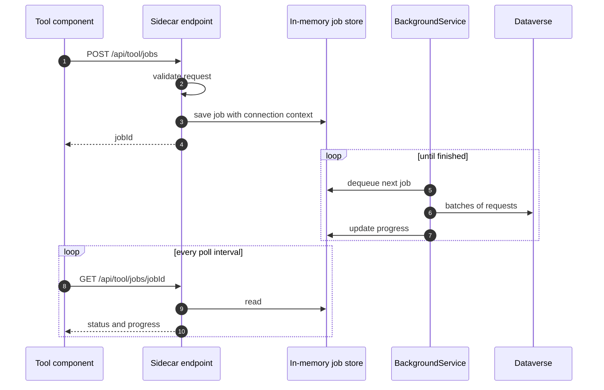

## 10. Connections, credentials, and local data

Details are in [`desktop/docs/connections.md`](../desktop/docs/connections.md).

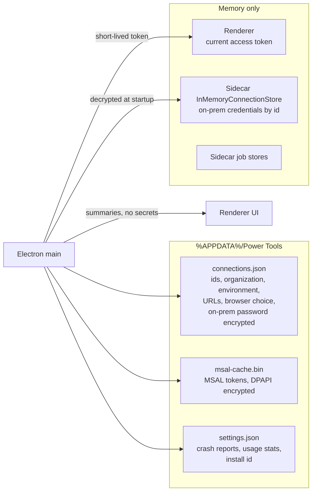

| Data | Where | Protection |
| --- | --- | --- |
| Connection list | `connections.json` in userData | No tokens. On-premises password stored as `safeStorage` ciphertext |
| MSAL token cache | `msal-cache.bin` in userData | `safeStorage` (DPAPI on Windows) |
| Settings | `settings.json` in userData | Plain JSON, no secrets |
| Access tokens in use | Renderer memory, request headers | Loopback only, cleared on connection switch |
| On-premises credentials in use | Sidecar memory | Lost when the app exits, re-registered at startup |
| Exported connections | File the user picks | No passwords, tokens, or account ids |

A connection is keyed by a hidden UUID. The UI shows "Organization · Environment" and never the id.

## 11. Security model

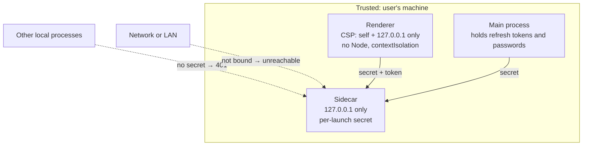

- The sidecar binds `127.0.0.1` on a random port. It rejects any request without the launch secret, compared in constant time.
- The renderer has no Node access and a strict CSP. Sign-in and Dataverse traffic stay in the main process and the sidecar.
- Refresh tokens and passwords stay in the main process, encrypted at rest with `safeStorage`.
- Main-process IPC handlers validate their inputs. URLs opened in a browser are parsed first.
- Crash reports exclude headers, bodies, query strings, local variables, user info, and network breadcrumbs.
- The sign-in window is sandboxed and uses the Microsoft "select account" prompt.

## 12. Updates, crash reports, and usage stats

| Feature | Module | Destination | User control |
| --- | --- | --- | --- |
| Auto update | `autoUpdate.ts`, `electron-updater` | GitHub Releases for `AbdallahNagy/PowerTools` | Update button and dialog. Packaged builds only |
| Crash reports | `sentry.ts`, `crashReports.ts`, `platform/sentry.ts` | Sentry, through the main process only | Help menu toggle |
| Usage stats | `usageStats.ts` | `POST /api/heartbeat` on the website worker, at most once a UTC day | Help > Send Anonymous Usage Stats. Packaged builds only |

The update dialog shows the GitHub release body, which comes from `CHANGELOG.md`.

## 13. Website

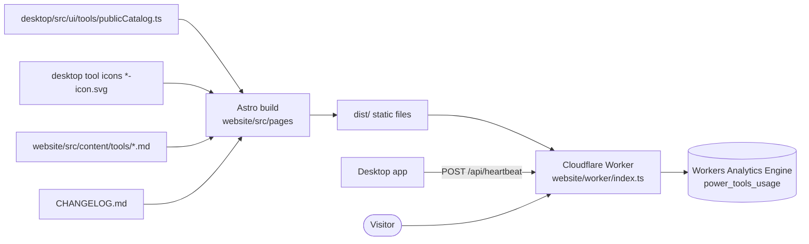

- Pages: home, tools list, one page per tool, download, changelog, contact, request a tool, sitemap.
- The tool list, tool pages, and sitemap come from `PUBLIC_TOOLS`. The build fails if a catalog tool has no Markdown page.
- The worker serves the static build and validates heartbeats. It does not store IP addresses.

## 14. Build, test, and release

### Tests

| Layer | Tooling | Location |
| --- | --- | --- |
| Main-process services | Vitest with fakes | `desktop/test/electron`, `desktop/test/*.test.mjs` |
| Renderer shell and shared UI | Vitest, Testing Library, jsdom, MSW | `desktop/test/renderer` |
| Tools | Vitest, MSW | `desktop/src/ui/tools/<tool>/tests` |
| Real Electron app | Playwright smoke test | `desktop/test/smoke/app.spec.ts` |
| Sidecar | xUnit, one project per tool, fake clients | `api/PowerTools/PowerTools.API.*.Tests` |
| Scripts | `node --test` | `scripts/changelog.test.mjs` |

`npm run check` in `desktop/` runs typecheck, lint with zero warnings, unit tests, the renderer build, and the smoke test.

### Pipeline

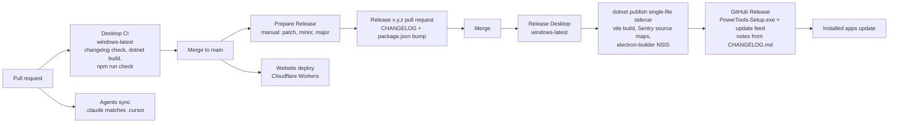

### Packaging

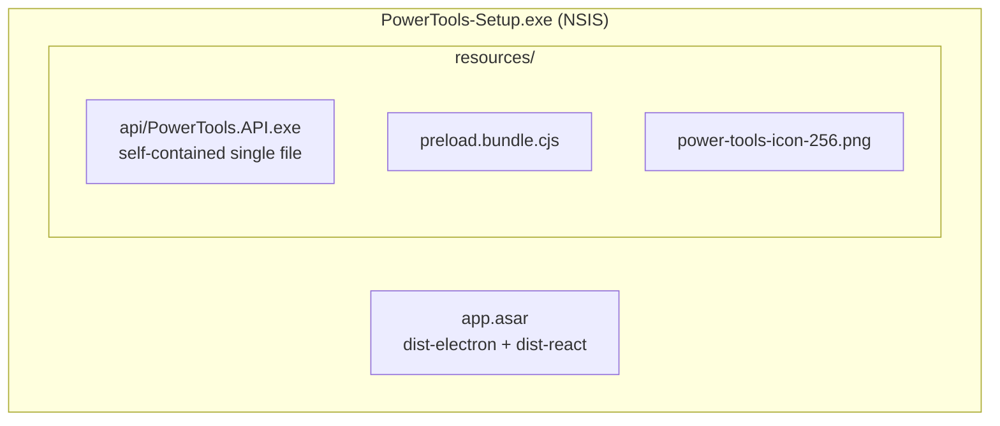

In development `npm run dev` starts Vite on port 5123, Electron, and the sidecar with `dotnet run`. Dev runs use their own userData folder.

## 15. Adding a tool

New tools go through the agent pipeline in [`desktop/docs/tool-building-pipeline.md`](../desktop/docs/tool-building-pipeline.md). Run it with `/build-tool <tool name>` in Claude Code.

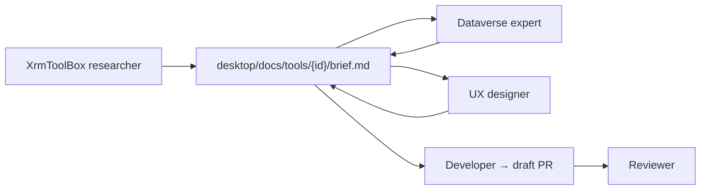

A tool change touches these places:

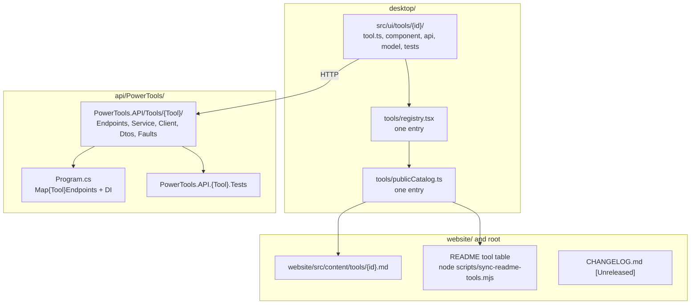

## 16. Design decisions and limits

| Decision | Why | Cost |
| --- | --- | --- |
| Dataverse calls go through a .NET sidecar | The official Dataverse SDK and the on-premises SOAP client are .NET. Plugin assembly inspection needs .NET reflection | A second runtime in the installer, and a startup wait for `LISTENING` |
| Sidecar on loopback with a per-launch secret | No firewall prompt, nothing on the network can reach it, other local apps cannot use it | Every request carries the secret |
| Tokens acquired in the main process | Refresh tokens stay out of the renderer and are encrypted at rest | The renderer asks over IPC for a token before calls |
| One connection per tab | Several environments can be open side by side | Each tool reads its connection from the tab, never from a global |
| In-memory job stores | Simple, no disk state, nothing left behind | Jobs stop when the app closes |
| On-premises credentials re-registered at startup | The sidecar holds no state between launches | Startup makes one call per saved on-premises connection |
| One tool catalog shared with the website | The app, README, and website cannot drift | The website build depends on desktop source files |
| Windows is the production target | The audience works on Windows, and browser profile discovery is Windows-only | macOS and Linux build scripts exist but are not released |
